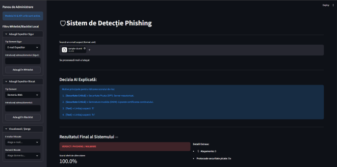
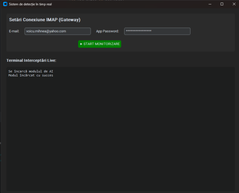
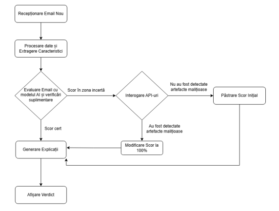
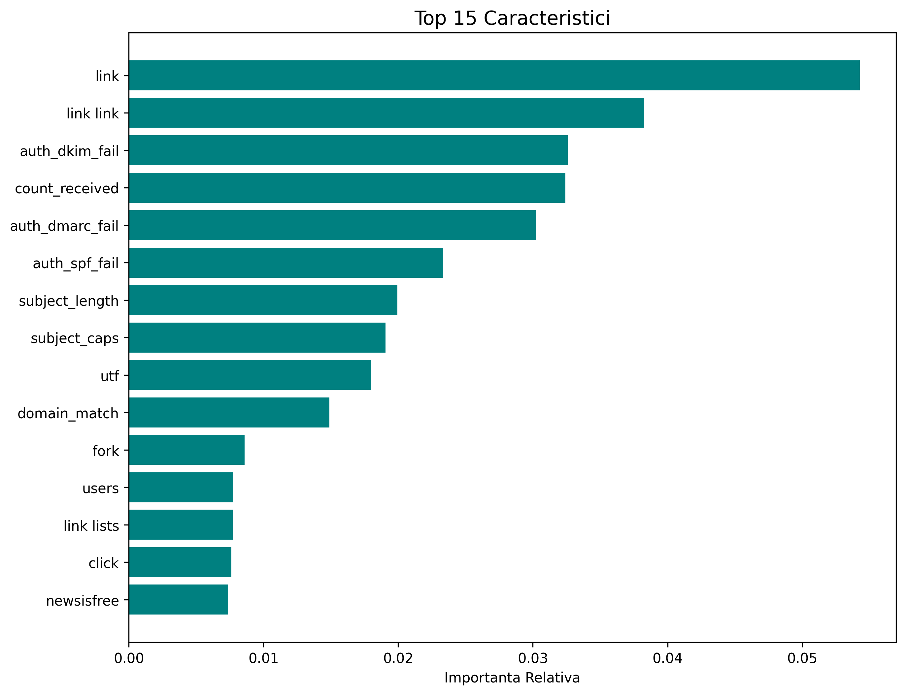
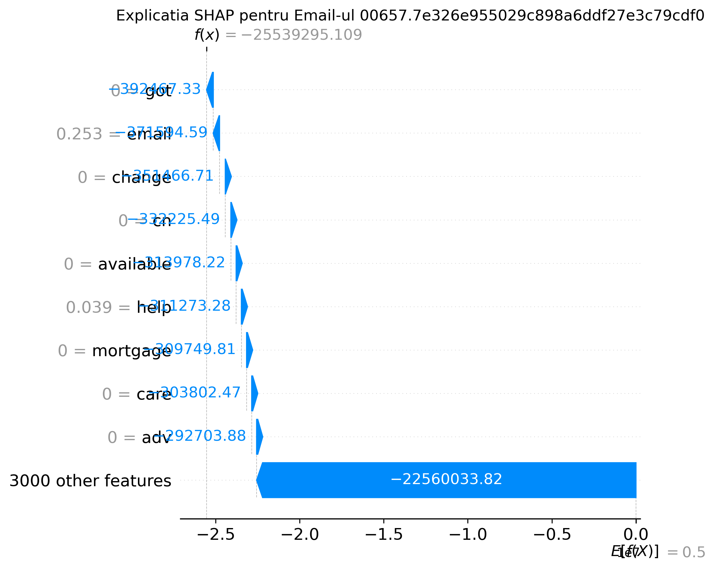

# 🛡️ AI Phishing Email Detection System

An end-to-end phishing detection and analysis system combining **Machine Learning (Random Forest + TF-IDF)**, **Threat Intelligence enrichment**, **Explainable AI (SHAP)**, and real-time email monitoring.

## Key Features
- **Hybrid Detection Engine:** Combines NLP text vectorization (`TF-IDF`) with email header and metadata heuristics (`SPF`/`DKIM`/`DMARC` validation, `Return-Path` and `Reply-To` alignment, `Received` hop count, subject anomalies) using an optimized **Random Forest** classifier.
- **Explainable AI (SHAP):** Generates feature-level explanations for every high-risk prediction, allowing security analysts to inspect which cryptographic failures, header anomalies, or keywords triggered an alert.
- **Threat Intelligence & Caching:** Integrates **VirusTotal** and **AbuseIPDB** APIs, local `whitelist.json` / `blacklist.json` rules, registrar datasets, and a local JSON cache (`threat_intel_cache.json`) to minimize API latency and rate-limit overhead.
- **Real-Time Monitoring & Web Dashboard:** Includes a real-time IMAP gateway monitor (`script_app_v_final.py`) alongside an interactive **Streamlit** web interface (`app.py`) for manual `.eml` triage and list management.

---

## System Interfaces & Decision Flow

### Web Triage Dashboard (Streamlit)

### Real-Time IMAP Gateway Monitor

### Hybrid Decision Flowchart

---

## Model Evaluation & Comparison

Three supervised learning algorithms were trained and evaluated on the combined email corpus using `GridSearchCV` (optimizing for **Macro F1-Score** while enforcing $\ge 95\%$ precision on legitimate emails to minimize false positives):

| Model | Accuracy | Macro F1-Score | Key Takeaways |
| :--- | :---: | :---: | :--- |
| **Naive Bayes (Optimized)** | 96.81% | 0.96 | Fast baseline, but higher false-positive rate on legitimate emails |
| **Logistic Regression (Optimized)** | 98.44% | 0.98 | Strong linear baseline, less resilient to complex non-linear combinations |
| **Random Forest (Final)** | **98.91%** | **0.99** | Best overall generalization, non-linear feature interaction & native SHAP support |

### Confusion Matrix (Optimized Random Forest)

### Feature Importance & SHAP Explanation

---

## Hybrid Threat Intelligence Scoring

When the Random Forest classifier outputs a probability within the **uncertainty zone (`0.30 – 0.90`)**, the system automatically extracts IOCs from the email and queries external Threat Intelligence APIs to dynamically adjust the final risk score:

| Verification Check | Malicious / Failed (`Risk Bonus`) | Clean / Valid (`Trust Bonus`) |
| :--- | :---: | :---: |
| **Sender Domain (VirusTotal)** | `+0.40` | `+0.25` |
| **Embedded URLs (VirusTotal)** | `+0.35` | `+0.15` |
| **Originating IP (AbuseIPDB)** | `+0.20` (score > 20) / `+0.40` (score > 50) | `+0.25` |
| **Attachment MD5 Hash (VirusTotal)** | `+0.50` | `+0.25` |
| **Email Auth (`SPF` / `DKIM` / `DMARC`)** | `+0.10` per failed check | `+0.35` (all valid) |

---

## Datasets Used for Training
To balance classic email structures with modern phishing lures, the classifier was trained on a combined dataset consisting of:
- **SpamAssassin Public Corpus:** ~6,000 legitimate (`ham`) and spam emails containing full SMTP headers.
- **Phishing Pot Corpus:** ~8,600 recent phishing samples collected via honeypots ([rf-peixoto/phishing_pot](https://github.com/rf-peixoto/phishing_pot)), supplemented with recent legitimate email samples to prevent class bias.

---
