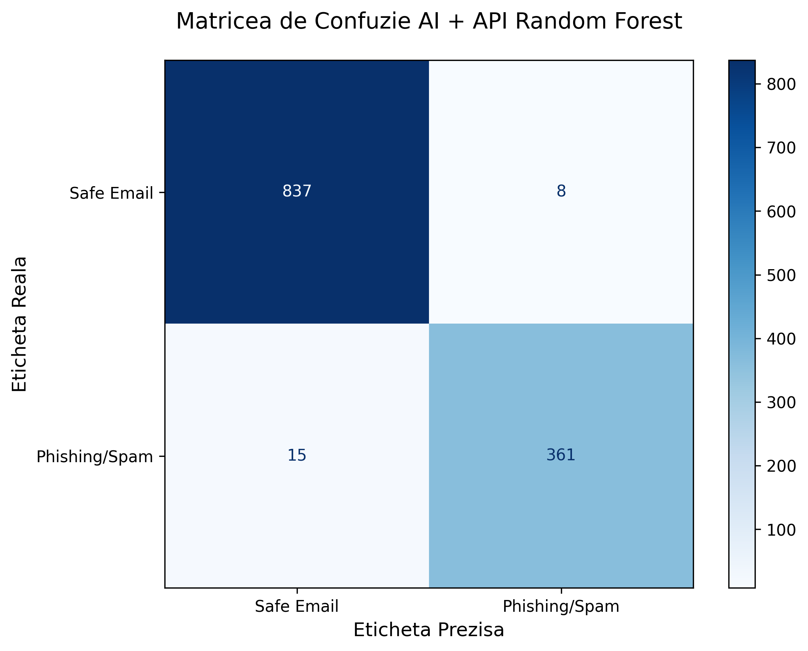

#  AI Phishing Email Detection System

An end-to-end phishing detection and analysis system combining **Machine Learning (Random Forest + TF-IDF)**, **Threat Intelligence enrichment**, **Explainable AI (SHAP)**, and real-time email monitoring[cite: 18].

##  Key Features
- **Hybrid Detection Engine:** Combines NLP text vectorization (`TF-IDF`) with domain/metadata heuristics (registrar reputation, URL structure, header anomalies) using an optimized **Random Forest** classifier[cite: 18].
- **Explainable AI (SHAP):** Generates waterfall explanations for every prediction, allowing security analysts to inspect which exact features triggered a phishing alert[cite: 18].
- **Threat Intelligence & Caching:** Integrates external threat feeds, local `whitelist.json` / `blacklist.json` rules, registrar datasets, and a local cache (`threat_intel_cache.json`) to minimize API latency[cite: 18].
- **Real-Time Monitoring & Web Dashboard:** Includes a real-time email ingestion script (`script_in_timp_real.py`) alongside an interactive web interface (`app.py`) for manual triage[cite: 18].

##  Model Performance & Explainability

### Confusion Matrix (Optimized Random Forest)

### Feature Importance & SHAP Waterfall Explanation

